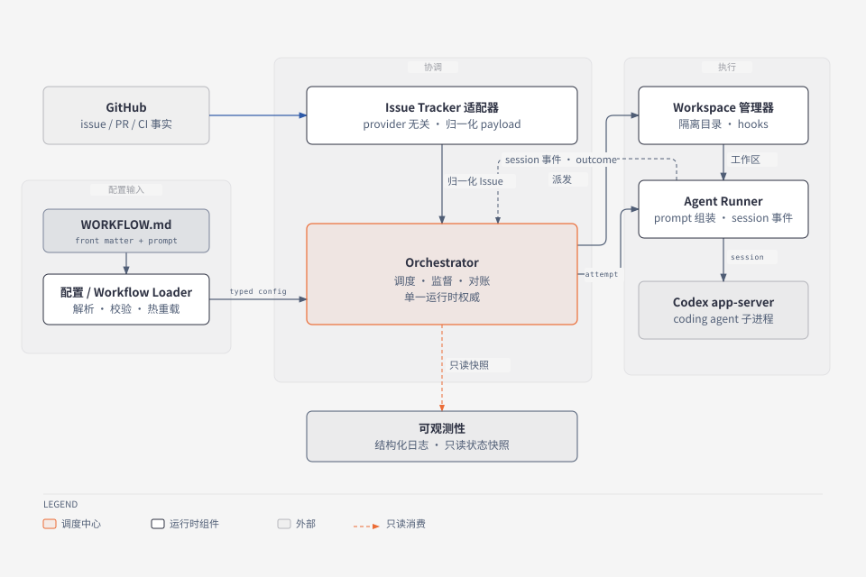
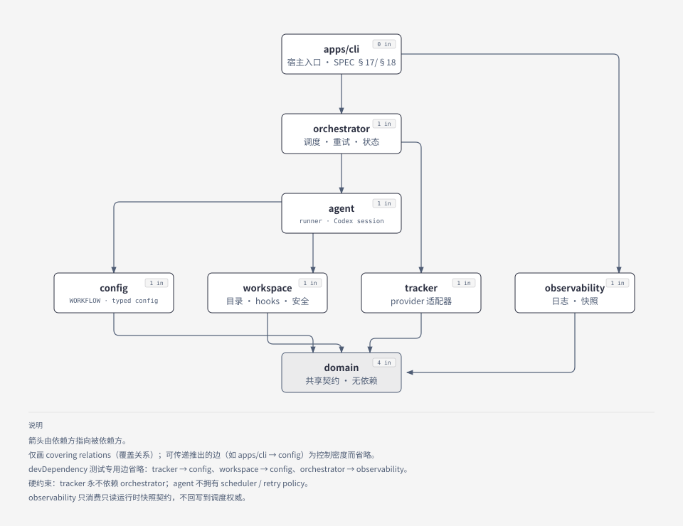
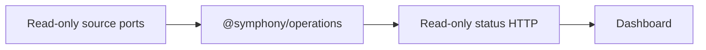

# 架构

> 本文件只记录**稳定架构**：产品模型、组件职责、依赖方向与进程 / lifecycle 契约。当前实现状态、里程碑、deferred 与 next work 只在 [status.md](status.md) 维护；SPEC 逐项能力与验收证据见 [conformance.md](conformance.md)；装配与测试入口见 [testing.md](testing.md)。

## 产品模型

symphony-ts 是 [OpenAI Symphony](https://github.com/openai/symphony) 官方 `SPEC.md` 的 TypeScript 实现（baseline 固定与升级规则见 [upstream.md](upstream.md)）。Symphony 是一个**长运行的 orchestrator**：从 issue tracker 读取工作，为每个 issue 建立隔离 workspace，运行 coding agent，并负责 retry / reconciliation / observability。

运行模型（SPEC §3）：

```
WORKFLOW.md → Config → Issue Tracker → Orchestrator → Workspace → Agent Runner → Observability
```

（上面的顺序是 SPEC §3 的组件列举，不是一条单向数据管道；运行期以 `Orchestrator` 为中心协作，见下方架构图。）

1. **Workflow Loader** 解析仓库内的 `WORKFLOW.md`（YAML front matter + 原始 prompt 正文）；
2. **Config Layer** 产出 typed config：默认值合并、`$VAR` 环境解析、tilde 展开 / 相对路径规范化、无效配置类型化报错并安全回退；
3. **Issue Tracker Adapter** 按配置轮询符合条件的工单，把 provider payload 归一化为 Issue（保留 provider keys）；
4. **Orchestrator** 维护单一权威 runtime state：claim 集合、并发上限、dispatch 排序、retry / backoff 队列与 reconciliation；
5. **Workspace Manager** 为每个 issue provisioning 隔离目录（id 净化、防碰撞），校验路径 containment，执行生命周期脚本；
6. **Agent Runner** 组装注入 issue 上下文的 prompt，启动 coding agent 子进程（如 Codex app-server），向上转发 live session 事件（token / turn / PID）；
7. **Logging / Status Surface** 输出结构化日志（保留关键标识符），并以只读 snapshot 提供面向操作者的状态出口。



上图是运行模型的权威可视化：`Orchestrator` 是中心 hub，`WORKFLOW.md` 经 Config / Workflow Loader 变成 typed config 进入调度；Issue Tracker Adapter 只做 provider 归一化，GitHub 是其外部持久事实来源；Workspace Manager 与 Agent Runner（驱动 Codex app-server 子进程）由 orchestrator 派发，Agent Runner 再通过 session 事件与 attempt outcome 向 orchestrator 回传监督事实；Observability 只消费只读 snapshot。英文版见 [runtime-architecture（English）](diagrams/runtime-architecture.svg)；可编辑源与再生成步骤见 [docs/diagrams/](diagrams/README.md)。

## Workspace 职责与依赖方向（SPEC §3 映射）

| 包 | SPEC §3 组件 | SPEC sections | 职责 | 依赖 |
|---|---|---|---|---|
| `packages/domain` | —（共享契约） | §4 | Issue、WorkflowDefinition、ServiceConfig、Workspace、RunAttempt、LiveSession、RetryEntry、OrchestratorRuntimeState 等类型与纯逻辑的唯一权威 | 无 |
| `packages/config` | Workflow Loader + Config Layer | §5、§6 | `WORKFLOW.md` 发现 / 解析、front matter schema、typed 校验、env / path resolution、模板渲染、热重载回退 | domain |
| `packages/tracker` | Issue Tracker Adapter | §11 | provider 无关的读取接口、认证、payload → Issue 归一化 | domain（`config` 仅为 devDependency，见下） |
| `packages/workspace` | Workspace Manager | §9 | 隔离目录 provisioning、containment 校验、lifecycle hooks | domain（`config` 仅为 devDependency，见下） |
| `packages/agent` | Agent Runner | §10、§12 | prompt / 上下文组装、coding agent 子进程控制、session 事件流 | domain, config, workspace |
| `packages/orchestrator` | Orchestrator | §7、§8、§14、§16 | 状态机、polling / scheduling / reconciliation、retry / backoff、单一权威 runtime state | domain, config, tracker, workspace, agent |
| `packages/observability` | Logging + Status Surface | §13 | 结构化日志、只读 runtime snapshot、OperationalSnapshot HTTP transport | domain + operations |
| `packages/operations` | Operational Read Model（Observation Plane） | §13 邻接 | provider-neutral 只读 facts 与投影契约的公共边界；四源只读 reader、确定性 projector、跨源异常检测与进程内查询服务 | domain（Decision / tracker 为测试 devDependencies） |
| `packages/decision` | —（Decision 扩展） | §4、Decision 扩展 | 任务/会话持久化快照存储、跨进程排他锁、Web Agent Bridge 本地 HTTP 服务、执行器适配层 | domain |
| `apps/chatgpt-web` | —（Decision 执行器） | Decision 扩展 | ChatGPT Web 执行器适配器与 Tampermonkey 浏览器决策驱动器 | domain, decision |
| `apps/cli` | —（宿主入口） | §17、§18 | CLI / 进程生命周期、组件装配 | domain, config, tracker, workspace, agent, orchestrator, observability, operations, decision |
| `apps/dashboard` | —（Observation consumer） | §13 邻接 | 只读 Overview / Work list / Work Detail | 浏览器仅 operations 类型；Node-only demo 依赖 operations + observability |

依赖只允许自上表"依赖"列的方向流动；新增跨包依赖前先读 [AGENTS.md](../AGENTS.md) 的扩展点表。表中的"依赖"列指**运行期**（`dependencies`）方向；为了证明跨包接线而引入的 **devDependency / 测试专用**边不视为违反方向流动，但必须在表里显式标注。当前两条例外：`packages/tracker` 与 `packages/workspace` 各以 devDependency 引用 `@symphony/config`（各自仅 `src/config-integration.test.ts` 使用），用来证明扩展点或 typed 契约两侧真的对得上——`@symphony/config` 侧不引用它们，运行期方向仍是 `tracker → domain`、`workspace → domain`。两条硬约束：

1. **tracker 永不 import orchestrator**——轮询节奏 / claim / 调度属 coordination 层；
2. **agent runner 不拥有 scheduler / retry policy**——coordination 只由 orchestrator 拥有。



依赖图只画 covering relations（省略可由传递推出的边以控制密度）：箭头指向被依赖方，`apps/cli` 位于顶端、`@symphony/domain` 位于底端并汇聚全部包。tracker 不依赖 orchestrator、agent 不拥有 scheduler / retry、observability 只消费只读 snapshot 都能由图形结构直接读出；devDependency 测试边（tracker → config、workspace → config、orchestrator → observability）不计入生产依赖，因此不出现在图中。英文版见 [package-dependencies（English）](diagrams/package-dependencies.svg)。

`observability` 对 orchestrator state 的消费是**只读 snapshot 契约**（类型归属 domain），不回写、不参与调度。

#137 的浏览器读取路径为 `source ports → @symphony/operations → @symphony/observability read-only HTTP transport → browser consumer`。HTTP 只调用注入的 `OperationalQueryService.getOperationalSnapshot()`，不读源、不推导状态、不回写；同步 runtime projector 仍独立保持 domain-only。默认 loopback + 临时端口，显式启动/关闭，异常仅影响 HTTP response。源包不得反向依赖 operations；observability 是允许的下游 consumer。依赖图展示 Core 包关系，新增 operations transport 依赖以上表为准。决策见 [HTTP transport Note](../notes/accepted/architecture/2026-10-16-operational-snapshot-http.md)。

`operations` 是 **Observation Plane / 只读投影与查询层**的公共边界：provider-neutral facts 与投影契约归 `@symphony/domain`，四源 source reader、确定性 projector、跨源异常检测与进程内查询服务（`createOperationalQueryService`）在 `@symphony/operations` 实现，运行期只 import `@symphony/domain`；相应源由宿主通过只读 ports 注入。GitHub（durable Work truth）、Orchestrator（scheduling authority）与 Decision Plane（durable planning / review state）仍是各自权威；`operations` 不参与调度、不写回任何权威源、不引入第二套 workflow 状态机，phase / waiting / attention / health 均为派生展示概念。

## 历史：M0 协议栈 scaffold 已删除

M0 / M0.5 曾把 Symphony 理解为 `sym/0` 消息协议 + protobuf wire + 可靠 UDP + gateway + relay + 插件协议栈，与官方 SPEC 无对应关系；M0.6 已整体删除（sym / proto / transport / gateway / plugins / relay / ctl / examples），历史仅存于 Git。决策与被否备选见 [align-with-upstream-spec note](../notes/accepted/architecture/2026-09-26-align-with-upstream-spec.md)。

## 只读 snapshot

`@symphony/domain` 是 snapshot/view/clock/result 共享类型权威，`@symphony/observability` 从 authority 当前 state 同步投影。无第二份 scheduler/config authority；snapshot 不作为 scheduling 输入。host 注入与 authority 同源的 monotonic clock 及 wall clock，读 snapshot 不入账 tokens/duration。retry URL 仅为可选 metadata，重排更新与显式 null 语义见 [决策 Note](../notes/accepted/architecture/2026-10-03-observability-snapshot.md)。orchestrator → observability 仅 devDependency 测试边，生产依赖方向不变。logger/observers 独立消费提交点事实，不从 snapshot diff 推断事件；生产 CLI host 通过相同 ports 装配；OperationalSnapshot HTTP transport 已由 #137 提供；生产 CLI lifecycle 接线见下方 #140 composition。

## Executable lifecycle

`args.ts` 解析 argv/path，`host.ts` 管理进程无关资源，`lifecycle.ts` 的 `runCli` 安装本次 signal/fatal handlers 并返回退出码，`bin.ts` 只设置 `process.exitCode`。顺序固定为 argv → path → initial config/tracker preflight → runtime/observability 装配 → SIGINT/SIGTERM handlers → watcher monitoring → loop。config 的 `autoStart: false` 延迟 interval；其他调用者默认仍自动监听。

host stop 同步关闭 EffectiveRuntime 提交与 watcher，再调用既有 loop.stop 的同步前缀关闭 authority 调度；等待 startup/tick/worker/cleanup 后输出最终 lifecycle 日志并关闭 logger，shell 最后移除本次 handlers。重复信号与 stop 共享收口 promise；失败优先；信号取消正常启动不会记录 startup completed。timer 迟到回调、closed reload/preflight 均不复活 runtime。原有 scheduler、attempt/root 绑定、session.stop → after_run 与 transport TERM→KILL 保持唯一实现。

文件、用例名和命令见 [conformance.md 的 Core 证据索引](conformance.md#m65-core-证据索引)，设计取舍见 [lifecycle Note](../notes/accepted/architecture/2026-10-03-cli-process-lifecycle.md)。

## Decision Plane protocol extension

`@symphony/domain` owns the provider-neutral [Decision protocol](decision-protocol.md): Issue-root session identity, versioned Plan/Review facts, exact HEAD review approval, lease fencing and executor binding generations. Pure validators/transitions have no I/O or reverse dependencies. Conversation continuity is advisory; it never supplies authoritative workflow state. This independent extension preserves Symphony §7 orchestration and current delivery behavior.

`@symphony/decision` provides durable task/session snapshot persistence, single-writer process lock (`store.lock`), lease coordination, and the localhost Web Agent Bridge HTTP server. Subpath `@symphony/decision/adapter` defines browser-safe executor adapter primitives, context strategies, and fail-closed result extraction. `apps/cli` exposes the bridge via `symphony decision bridge`. `apps/chatgpt-web` delivers the concrete browser-side userscript adapter and driver. See [Decision Note](../notes/accepted/architecture/2026-10-08-decision-contracts.md), [Decision Store & Bridge Note](../notes/accepted/architecture/2026-10-09-decision-store-bridge.md), [Executor Adapter Note](../notes/accepted/architecture/2026-10-09-decision-executor-adapter.md), and [ChatGPT Web Adapter Note](../notes/accepted/architecture/2026-10-10-chatgpt-web-adapter.md).

Operational source acquisition uses injected read-only ports. GitHub delivery supplies a marker-validated observation, runtime supplies the existing snapshot, Decision supplies a synchronous committed-state whitelist view, and executor supplies an explicit inventory or remains unknown. Freshness policy is source-specific; collection waits for all reads and retains independent failures. See [source readers note](../notes/accepted/architecture/2026-10-13-operational-source-readers.md).

## Execution Continuity and recovery extension

`@symphony/domain` 定义跨阶段执行连续性、所有权防御（fencing）与故障分类的共享语言（`src/execution-continuity.ts`，NEST-130 / GitHub #146），作为 §4 邻接的 recovery extension，并严格保持与既有 §7（调度状态机）、§8（调度与对账）、§14（重试与回退）以及 Decision Plane / Delivery 的单一权威事实边界一致：

1. **权威边界不变**：GitHub 拥有 Issue / PR / CI 的远端事实权威；Orchestrator 拥有进程内调度与 worker 生命周期权威（§7、§8）；Decision 拥有计划/审查任务与租约所有权（NEST-99、NEST-100）；Delivery 拥有交接与分支合并确认权威（NEST-91、NEST-128）。Continuity 契约仅作为声明式的跨阶段观测与意图表达，不建立第二套持久化 store 或状态转移引擎。
2. **状态与重试语义**：`ContinuityState`（`running`, `retry_queued`, `recovering`, `blocked`, `completed`, `released`）将 `blocked` 作为一等非终态（区别于 terminal failure 或 retry queued），解除后走重观测再决策。重试语义固定为 **re-observe + re-decide**，禁止盲目重放。
3. **多维所有权防护（Fencing）**：保留 retry token、lifecycle generation、reconciliation epoch、Decision lease generation、binding generation 与 expected HEAD SHA 等多维原生证据，旧续体仅允许观察、禁止跨作用域突变当前工作。
4. **子系统映射与缺口记录**：五类故障分类（`transient`, `recoverable`, `blocked_external`, `superseded`, `invariant_violation`）为现有错误提供显式归一；无充分上下文的错误（如裸 `execution_failed`）显式返回 `unmapped`，不隐式默认成可重试故障。详见 [Execution Continuity Note](../notes/accepted/architecture/2026-10-17-execution-continuity-contracts.md)。

Work-level reconciliation (NEST-138 / #147) lives in `orchestrator/work-continuity.ts`, composed by the CLI host from native tracker/runtime/Decision/Delivery sources. It derives diagnostics rather than another lifecycle. Each bounded delegation is preceded by fresh observation and followed by readback; mutations remain with transactional Decision reclaim or the filesystem-locked Delivery authority. Uncertain side effects retain their native recovery identity across scans until authority evidence resolves them; clocks and unrelated changes cannot authorize replay. Managed merged PRs wait for tracker synchronization; other-target active Decision tasks remain conflicts. The bridge has no independent expired-claim sweep; the work-aware coordinator owns recovery policy. Certified pre-mutation refusals do not enter uncertain-commit suppression. After remote I/O, keyed tracker facts must still match admission, alongside Decision/Delivery checks. Merged is a stage boundary; live runtime/plan ownership is contradictory. Coding still uses the existing dispatch loop. `host.workContinuity.observations` exposes credential-free diagnoses. See [work-level continuity note](../notes/accepted/architecture/2026-10-20-work-level-continuity.md) for stage support, lifecycle and deferred recovery boundaries.

Poll inventory failure skips that tick's candidate dispatch. Host launches and retry timers use `OrchestratorAuthority.dispatchIssueWithRefresh` / the same injected native-source admission port, returning a current Issue for the existing synchronous commit rather than caching permission. Retry observation failure preserves its reservation through bounded backoff; explicit blockers deny execution. Remote PR/CI observation does not depend on local workspace existence. Shutdown and generation/retry-token fences are checked after source I/O.

Decision/Web continuity adds optional task-scoped execution metadata to the existing Decision authority. Lease renewal consumes meaningful stage/response progress rather than heartbeat age; stalled renewal stops before the work-aware coordinator can reclaim an expired lease. Native recovery budgets and nonterminal blocks survive store restart. The Web adapter awaits fenced authorization before navigation/Send; userscript enabled/Stop intent survives page loss without sharing another tab's lease. Browser availability is an explicit host wait. See the [implementation decision](../notes/proposed/architecture/2026-10-21-decision-web-continuity.md) and [protocol](decision-protocol.md#decisionweb-execution-facts). No browser supervisor, automatic login or Operations mutation path is added.

The [native durable handoff implementation](../notes/proposed/architecture/2026-10-22-durable-recovery-invocations.md)
adds synchronous injected storage ports for recovery invocations and retry/launch
reservations, and explicit continuation/landing markers in Delivery's existing state.
The host restores native intents after preflight and re-observes current authority
facts before action. Review receipts reuse the same plan/target round; stage recovery
skips coding. Merge acknowledgements share the native Delivery lock and exact-target
opt-in. Scheduled retries restore from UTC deadlines; uncertain worker launches,
repairs and subprocesses remain explicitly blocked until operator verification.
No second business lifecycle, supervisor or Operations mutation path is introduced.

NEST-134 / #150 adds the [bounded recovery policy and incident boundary](bounded-recovery.md).
Domain owns safe evidence contracts; orchestrator selects finite capability-aware
strategies; CLI persists reservations/blocks/incidents atomically and composes a
separate marker-verifying GitHub reporter. Native Decision/Web limits and ownership
fences remain authoritative. Unknown effects block rather than replay. The reporter
has a finite outbox budget and never recursively creates incidents. Operations and
Dashboard gain no mutation authority. See the
[decision note](../notes/proposed/architecture/2026-10-22-bounded-recovery-incidents.md).

Acceptance of these boundaries is indexed in the [execution-continuity ledger](evidence/execution-continuity/README.md). Durable intent → effect → acknowledgement preserves native ownership; unknown outcomes block. Bounded convergence includes explicit external waits and human blocks, not guaranteed business completion during unlimited outages. Neither the ledger nor Observation Plane grants mutation authority.

## Dashboard observation consumer (#138)

`apps/dashboard` is an app workspace with DOM components and Vite, downstream of operations. Browser imports are type-only from the public operations contract; Node-only `examples/` inject controlled SourceReaders into the real query service and #137 HTTP server. A separate loopback static host proxies only `/api/operations/snapshot` without JSON transformation or CORS. The opt-in CLI composition described below owns production sources, scope and lifecycle. Removing the Dashboard cannot affect scheduling.

Only operations derives phase, waiting, attention, health, approval and counts. `degradedWork?` counts exactly degraded attention; `anomalyCount?` comes from final canonical anomaly deduplication. UI displays missing optional counts explicitly. Dependency/import graphs, capability/AST/type guards, closed helper fingerprints, negative fixtures, production bundle inspection and frozen inconsistent-projection tests protect this boundary. See [decision](../notes/accepted/architecture/2026-10-22-dashboard-consumer.md).

## Work Detail diagnostics (#139)

The [Work Detail decision](../notes/accepted/architecture/2026-10-22-work-detail-diagnostics.md) keeps the existing WorkKey hash and v1 snapshot. `detail.ts`, `evidence.ts` and `anomaly.ts` render supplied data; `identity.ts` selects by full provider/key and groups by source/role without changing entries. Foreign embedded evidence is hidden; work-scoped sources, global sources, associated executors and global anomalies remain distinct. Exact targets and result verdict are independently inspectable. The list raw HEAD foldout remains available. Wire shape validation, registered presentation calls, pinned reviewed helpers/renderers, type/capability/graph guards and negative fixtures preserve operations as the sole semantic owner. There is no workflow command; production assembly belongs to the CLI composition below.


## Production status composition (#140)

The Observation Plane data flow (arrows denote data, not package imports) is:



`apps/cli/src/status.ts` composes sources → `@symphony/operations` → read-only observability HTTP → same-origin Dashboard. CLI is the only composition root importing source and query packages together. Browser imports operations types only; no Node, source adapter, store, projector or Vite/HMR runs in the browser bundle. UI never derives phase/waiting/attention/health or review validity. See the [composition decision](../notes/accepted/architecture/2026-10-23-production-status-composition.md).

`--status` is opt-in, loopback-only, with OS-assigned port by default. Repeated `--status-work github:owner/repo#N` defines the whole observation scope; empty scope is valid, not a claim of system idleness. Host snapshots retain their original time and map runtime work only through verified GitHub issue URLs. Completed scoped work remains visible. No tracker/global Decision scan expands scope.

GitHub uses `observeWork` with the existing `GH-N` / `symphony/GH-N` naming convention, verified repository default branch and marker/branch/repository checks. Nonstandard delivery identities are not guessed; association failures are unavailable. Configured tracker credentials are resolved through the existing profile and used by the read-only GitHub subprocess runner. The entire observation has a 3-second subprocess budget with native process-group cleanup. Runtime is the same host's `tryGetSnapshot`. Local Decision reuses the already-open service; Bridge uses authenticated `GET /v1/observations/work?provider=...&key=...`, one committed whitelist read, with a 3-second abort budget. No second store, continuity read, lease cleanup or authority operation is used. Executor inventory is an explicit embedding port; absent inventory is unknown, successful empty inventory is fresh. Default freshness age is 30 seconds; clocks/policies can be injected at the composition boundary. Cross-source reads are not a transaction.

The CLI build first builds Dashboard and copies its static output next to the executable. Asset resolution is relative to the executable, independent of cwd. Production hosting injects a display-only mode marker into HTML; demo keeps its visible demo label. Fixed snapshot GET passes JSON through unchanged; unsupported snapshot methods are 405, other API paths 404. No streaming, journal, persistent operational cache, analytics or operator actions are introduced.

Status startup/asset/bind failures emit sanitized diagnostics and leave host admission running. Status errors never enter `host.failure`. Native host stop synchronously fences new observation requests, stops scheduling, drains owned reads before releasing the shared store, and continues native cleanup if status cleanup fails. Client disconnects do not cancel workers. There is no status supervisor. Loopback is not an authentication system; snapshots can contain identifiers and workspace paths. See the [acceptance evidence](evidence/status-surface/README.md).
