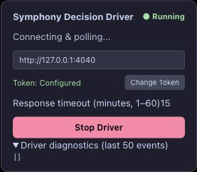

# #162 agent-managed tab quit/reopen comparison — 2026-10-23

SPEC §4 adjacent, §7/§8/§10/§12/§14/§17/§18; [baseline](../../upstream.md).
Runtime source `937e9d6d9e74c90f736137d897efdca856444594`, with the prior type-only
HeartbeatTaskRequest correction. No additional runtime changes in this experiment.

**Result: seamless resume failed again; complete-host bounded blocking passed for
this variant.** Old browser process absence and explicit reopen were verified.
The restored browser tab kept its browser ID but had a new session identity, home
URL and empty Driver diagnostics. Its original execution blocked 23.019 seconds
after final lease expiry. This completes the previously interrupted agent-tab
experiment without claiming full closure of #162/#145/#151.

## Composition and sequence

Fresh isolated production createHost + authenticated DecisionBridge/durable store,
loopback proxy 4040 → 4041, installed Edge/Tampermonkey Driver, real GitHub adapter
reads scoped to #162. Coding dispatch and remote incident reporting were disabled.
The synthetic materialized Plan asked for long local CLI failure analysis only;
no browsing, connectors, repository mutation or GitHub effects were requested.
Private files remain in `/private/tmp/symphony-162-agent-20261023`.

1. Agent-created tab `34634957` started at `https://chatgpt.com/`. Driver was Idle,
   Token Configured; Start was explicitly clicked. Bootstrap completed, binding
   generation became 1, actual task Send occurred, and response generation began
   at `https://chatgpt.com/c/6adb1c4e-3928-83ea-8421-7e937f236d0b`.
2. [Pre-exit HUD diagnostics](agent-browser-hud-before-2026-10-23.json) record one
   actual `prompt_submitting`, then `waiting_response` and a new generating turn.
   Final successful progress heartbeat: **16:36:45.858 Asia/Shanghai**, response
   length 21,589, claim generation 1, binding generation 1, receipt absent.
3. Native Edge menu **Quit Microsoft Edge** was clicked. Read-only process-table
   inspection confirmed old main PID **8768 absent**, with no matching Edge main
   process. No shell/CDP kill or browser-state inspection was used to cause exit.
   Absence was recorded at **16:37:05.953** before any reopen call.
4. Native `getApp` explicitly reopened Edge. Main PID was **32189**. The extension
   reconnected under a new connection identity; inventory found the original browser
   tab `34634957` in its agent-created group, now at **ChatGPT home**, rather than
   the task conversation. Driver automatically Running/polling; [HUD diagnostics
   were empty](agent-browser-hud-after-2026-10-23.json). No task was adopted or resent.
5. Native DevTools **Application → Session storage → https://chatgpt.com**, filtered
   to `symphony`, read `symphony_tab_id = tab_1792744643640_szml5m5a`. The timestamp
   embedded by the current `getOrCreateTabId` implementation is **16:37:23.640**,
   after the old process was gone. This is a newly created identity, not evidence
   that the original task had no persisted checkpoint. DevTools was closed afterward.
6. The original lease expired **16:38:45.858**. The host's fenced recovery wrote
   native `execution.blocked.reason = human_required` at **16:39:08.877**, exactly
   **23.019 seconds** later, with conversation/receipt inspection instructions. The
   host configured 2-second polling, but fresh remote reads add scan latency; do
   not equate the scheduling interval with a strict two-second wall-clock bound.
7. [Task/incident and fencing readback](agent-browser-result-2026-10-23.json) shows
   native status still `running`, but host diagnosis `blocked` / `require_human`.
   Local [operator CLI incident list](agent-browser-incidents-2026-10-23.json) is
   nonempty. Receipt HTTP 404; `/next` 204; replacement claim 409; old heartbeat 409.
   Claim/binding generation remain 1; [HTTP trace](agent-browser-http-2026-10-23.ndjson)
   has one task start and **zero result POSTs**. The final readback, repeated after the progress deadline, preceded cleanup.

## Diagnosis and supported boundary

Observed failure mechanism: the restored browser tab is not a continuation of its
original session-storage identity. Driver lookup uses
`symphony_driver_checkpoint_v1_${tabId}` and its diagnostic history is also keyed
by that identity. A browser-level tab ID therefore cannot prove recovery continuity.
The fresh identity explains why an existing old-identity checkpoint would not be
looked up; importing that checkpoint/token would violate cross-tab fencing.

The original ID was not directly captured before quit, but the restored ID's embedded
creation time is after old-process disappearance. Old GM checkpoint keys/values
were **not** directly inspected, copied or modified. Consequently this experiment
does not establish GM data loss, cannot distinguish all browser versus automation
restore causes, and does not warrant relaxing per-tab isolation. The prior
[native-created test window](bounded-browser-acceptance-2026-10-23.md) disappeared
rather than returning home, so native/agent window topology also differs.

The confirmed support boundary is: auto-start intent survives, seamless original
page/checkpoint restoration is not guaranteed, and a complete host with available
current source observations conservatively blocks uncertain sent work after lease
expiry. Standalone Bridge polling does not own this convergence policy. No universal
bound under unavailable GitHub sources, crash/SIGKILL coverage, installed-byte identity,
or remote incident-posting success is claimed. The two observed expiry-to-block times
are 27.296 seconds (native separate window) and 23.019 seconds (agent tab).

## Validation

`npm test -w @symphony/chatgpt-web -- test/checkpoint.test.ts test/userscript-entry.test.ts`
passed **17 tests**. These cover per-tab isolation and fresh-identity auto-start/Stop;
they are fixture checks, not browser process tests. The existing complete-host
waiting-response regression remains linked in the previous follow-up. No source
code changed in this step, so prior full gate evidence remains applicable; the
new evidence and documentation require docs-check and diff-check.

## Cleanup

After the final blocked/fencing readback, the test Driver was explicitly stopped
through the HUD and its agent-managed tab closed. The isolated task was cancelled
only after evidence capture. Exact harness PID 31237 received SIGTERM, exited successfully, and listeners
4040/4041 were confirmed empty. The private
store and synthetic conversation are retained; ordinary user conversations and
GitHub business objects were not edited. Developer tools were closed after read-only
inspection; no storage key, token, browser setting or binding was manually changed.
