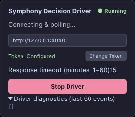

# Full browser process acceptance — 2026-10-23

NEST-135 / #151; parent #145; SPEC §4 adjacent, §10/§12, §17/§18.
Source: `ae8538d9774c6e25e8e6c9c22b886362d21761f1`.

**Result: automatic resume not accepted (W03).** A real Edge quit/reopen was exercised;
the restored test page polled for new tasks with empty diagnostics, while its original
claimed task stayed running/waiting_response and had no receipt. No repeated task Send
or result POST was observed. This result must not be counted as a successful browser
process restart. No runtime fix or claim of a proven root cause is included here.

## Composition and sequence

A fresh isolated production DecisionBridge/durable store and loopback proxy ran on
4040 → 4041. The operator-confirmed current Driver ran a synthetic materialized Plan
in an agent-created Edge tab. No coding host or GitHub mutation was involved. A result
barrier was configured but never reached; ACK dropping was disabled.

1. At 10:24:41 Asia/Shanghai, the Driver sent the actual task after bootstrap. At
   10:24:56.688, its real Stop-generation button was visible; persisted HUD contained
   one task prompt_submitting event. [Before-exit evidence](browser-process-before-2026-10-23.json).
2. The initial keyboard quit attempt did not establish exit. The native Edge menu
   Quit was then used. The browser control connection disappeared; after reconnect,
   the original browser tab ID was restored at ChatGPT home rather than the task
   conversation. Driver auto-started, but diagnostics were empty and it polled /next.
3. A second native Quit/reopen cycle on the same still-unresolved task independently
   verified the OS process boundary: Activity Monitor filtered to Microsoft Edge
   showed main PID 44029, then no matching rows, and native application inventory
   reported isRunning false. Edge was explicitly reopened with the native app API;
   Activity Monitor then showed main PID 44752. [Exit](browser-process-exit-2026-10-23.json),
   [reopen](browser-process-reopened-2026-10-23.json). No browser process was killed
   through shell/CDP or an alternative automation channel.
4. The restored original test tab again showed ChatGPT home, Running/polling and
   diagnostics []. It did not resume the original task. At 10:30:58 the native task
   was still running/waiting_response, claim generation 1, no block, receipt HTTP 404,
   zero result POSTs. Last successful task heartbeat was 10:25:07.343. The original
   live task [verification command](browser-process-verifier-2026-10-23.txt) exited 1.
   See [redacted native result](browser-process-result-2026-10-23.json),
   [HTTP trace](browser-process-http-2026-10-23.ndjson),
   [restored HUD](browser-process-hud-2026-10-23.txt),
   [provenance](browser-process-manifest-2026-10-23.json).

## Interpretation and limits

The required automatic-resume outcome was not established in this actual browser/tool
composition. Existing page-reload and result-ACK-loss passes remain valid for their
own variants. Process-wide quit/reopen is materially different and remains a blocker
to claiming complete browser-restart acceptance.

The restored tab used its initial home URL and empty diagnostics. The root cause has
not been isolated: browser/session restore, agent-tab lifecycle and Driver tab-identity/
checkpoint lookup must be separated before assigning a product defect or changing
persistence semantics. No extension storage was inspected or edited; no checkpoint
was manually copied between tabs. Reusing another tab's lease would be unsafe.

Only the isolated Bridge ran here, without host reconciliation. The claim was still
within its lease at the final observation; this run does not prove an infinite retry,
failed expiry reconciliation, or absence of later conservative human blocking. It
shows failed immediate automatic resume and observed no-duplicate safety only. A
native user-created tab/session-restore reproduction should distinguish tool lifecycle
from product behavior before a fix. Browser crash/SIGKILL and every restore policy
are not established by these clean-quit observations.

## Cleanup and validation

The test Driver was explicitly stopped, the isolated task was cancelled **after** the
failed readback, the exact test Bridge/proxy PID 43672 was stopped and loopback ports
checked empty. The temporary test tab was closed. Edge remains running with restored
user tabs; the synthetic ChatGPT conversation is retained. Activity Monitor's search
filter was restored to empty. No ordinary conversation, GitHub issue/PR/comment,
branch, browser setting or authentication store was changed.

Private stores/capabilities remain only in `/private/tmp/symphony-pr159-browser-process-20261023`.
Published HUD/trace contain no tokens or unrelated page/sidebar content. Browser UI
work used only the supported computer-use interface. Runtime sources and built Driver
are unchanged; earlier complete gate results are reused. Final evidence changes require
docs-check and diff-check. PR #159 stays Draft and parent #145 stays open.
