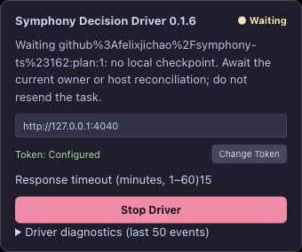
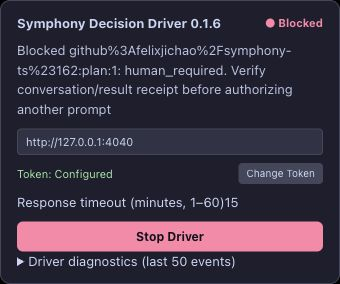

# #162 recovery visibility repair and live verification — 2026-10-23

SPEC §13 adjacent, §10/§12, §17/§18; [baseline](../../upstream.md).
Implementation: current uncommitted work atop `937e9d6d9e74c90f736137d897efdca856444594`.

**Result: restored-page recovery visibility repaired and verified with installed
Driver 0.1.6 after a real complete Edge quit/reopen.** The recovered page changes
from Waiting to Blocked using authoritative native facts, without importing the lost
tab's checkpoint or replaying its task. This verifies the conservative blocked path;
it does not establish seamless original-session resume or close parent #145.

## Failure reproduced and change

The prior [process-boundary experiment](agent-browser-acceptance-2026-10-23.md) lost
session-storage identity. The complete host safely blocked the task, but its fresh
page kept showing Running / empty diagnostics. Two new real-Bridge/store userscript
regressions first failed with `expected Waiting/Blocked, received Running`.

When checkpoint recovery has nothing local to resume and `/next` returns no claimable
task, `DecisionTabDriver` now reads the read-only `/v1/continuity` facts if its
HUD observer is attached. When the Bridge has an `authToken` configured, the transport
must supply Bridge Bearer authentication. The response exposes no task lease
credentials, and observing these facts does not authorize lease adoption. The page
displays unfinished owned work as Waiting with an explicit no-local-checkpoint instruction; native execution blocks as Blocked with
task ID, reason and operator inspection instruction. Terminal history is ignored.
The page cannot claim another tab's lease, infer success, reclaim or unblock from
these observations. Existing checkpoint/receipt recovery retains priority.

The observer does not change task/lease/binding authority, recovery budgets or host
policy. Polling continues so the status can refresh and other eligible tasks can be
received; Stop remains available. Current execution diagnostics return the HUD to
Running, and an empty unfinished set clears the old waiting/block message. A late
observation after Stop or driver replacement cannot overwrite Idle. Native checkpoint
blocked outcomes also render the Blocked indicator, rather than generic Running.

Version 0.1.6 is injected into both the metadata header and HUD from one build value.
No new userscript grants were added. Tampermonkey's [documented tab API](https://www.tampermonkey.net/documentation.php?locale=en#api:GM_getTab)
does not provide a proven whole-process restoration guarantee for this composition;
no new automatic identity-adoption mechanism was introduced.

## Installed-version experiment

A loopback artifact URL initially reached only Tampermonkey's intermediate install
page. That was not counted as installation. The operator then confirmed installing
0.1.6; the exact test page showed **Symphony Decision Driver 0.1.6** before and after
quit. The built artifact hash is in the [validation record](recovery-hud-validation-2026-10-23.json).
Installed bytes were not separately extracted; operator confirmation, visible version
and observed new behavior are the installed-version evidence.

A fresh isolated production createHost + authenticated DecisionBridge/durable store
and proxy used 4040 → 4041, with real GitHub reads scoped to #162. Coding dispatch and
remote incident reporting were disabled. The synthetic materialized Plan requested
long CLI failure analysis, with no browsing, connectors or external writes.

The actual task reached generating `waiting_response`; [pre-quit diagnostic
metadata](recovery-hud-before-2026-10-23.json) includes the actual prompt submission.
Native Edge menu Quit was used. Read-only process inspection confirmed old PID
**32189 absent**, with no Edge main process, before explicit native reopen. The new
main PID was **16774**. No shell/CDP browser termination was used.

The original agent tab `34635492` returned to ChatGPT home rather than the bound
conversation, just as in the failing experiment. Driver 0.1.6 auto-started and showed
**Waiting**, the original task ID, no-local-checkpoint text and instructions to await
the current owner/host reconciliation without resending. After expiry and native host
recovery, it automatically showed **Blocked / human_required**, with conversation/
receipt inspection instructions. No checkpoint, token or binding was manually copied.

[Native task and fencing results](recovery-hud-result-2026-10-23.json),
[HTTP trace](recovery-hud-http-2026-10-23.ndjson), and
[CLI-visible local incident](recovery-hud-incidents-2026-10-23.json) establish:

- Lease expiry → native human block: **22.913 seconds**. Two-second host scheduling
  still includes remote read latency; it is not a strict two-second wall-clock bound.
- Claim generation 1, binding generation 1; receipt HTTP 404; task start count 1,
  result POST count 0, and **zero Driver POSTs after quit**. The probe's rejected
  old-heartbeat/replacement-claim requests used the private backend endpoint separately.
- Old heartbeat and replacement claim HTTP 409; `/next` HTTP 204 while blocked.
  Native task status remains running, with execution.blocked and a Blocked host/HUD.

## Validation and limits

`TMPDIR=/private/tmp npm run gate` exited 0: **2312 passed, one opt-in skip**, including
strict builds, all tests, lint and docs-check. Web workspace: **219 passed**. New
regressions use actual HTTP Bridge/store wiring for missing
checkpoint wait/block display, no page mutations and terminal clearing, plus a held
response test that proves late reads do not override Stop. These are fixture-DOM
checks; the native process experiment above is recorded separately.

Seamless restoration, old GM checkpoint durability, other browser/session policies,
crash/SIGKILL and unavailable authoritative sources remain outside this acceptance.
The live setup intentionally did not publish the incident to GitHub. #162 remains
open pending maintainer scope/acceptance review; no issue/PR/comment/branch/label
was changed by this verification. The page now makes the already-safe conservative
convergence visible instead of silently appearing to poll successfully.

## Cleanup

After final evidence and fencing checks, the test Driver was stopped through its HUD
and its agent tab closed. Only then was the isolated task cancelled. Exact host PID
14492 received SIGTERM; local artifact server PID 37618 was also stopped. Private
store/evidence and synthetic conversation are retained. The installed 0.1.6 remains
available for normal operator use; no ordinary conversation was edited or deleted.
