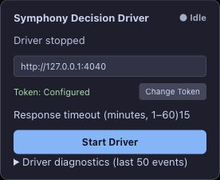

# PR #159 merge and environment verification — 2026-10-23

Scope: NEST-135 / #151; SPEC §4 adjacent, §7/§8/§14/§17/§18.

Source: merge `285ff58399ea1d8206a6f4758d9d378abaf65c19` (PR head `a37d9b9` + main `d1e855604dcb10c2b799744c57ef2cfe4fd4394d`). Five documentation
conflicts retain both the continuity acceptance ledger and Dashboard/Work Detail
contracts. No runtime implementation changed.

## Real local process observation

An isolated production DecisionBridge was bundled from this checkout using esbuild,
launched as an OS process with a fresh durable store, real wall clock and authenticated
HTTP on loopback 4040 → 4041. A synthetic Plan was claimed, started and explicitly
blocked through the native HTTP API (`auth_required`, recoveryCount 1).

The sandbox initially refused the SIGKILL. An attempted second startup correctly
failed with `store_locked` while the original process was still alive. After an
authorized SIGKILL of the exact test PID 98528, a new process reopened the same
store. The complete task/execution GET readback compared equal before and after
restart, including owner/generation/block/recovery count. No lockfile deletion or
production store mutation was used. See [redacted result](native-process-2026-10-23.json).

This is a real local Bridge process restart, not a full coding-host/browser restart.
The authentication block was injected through the native API, not observed in real
login UI. It provides partial W03 evidence and does not complete that matrix row.

## Real loopback ACK loss

A separate synthetic HTTP client submitted one ready Plan result. The proxy waited
for upstream 200 acceptance, consumed it and destroyed the downstream connection.
The client observed RemoteDisconnected, then recovered with GET receipt/result;
there was exactly one accepted result POST. A graceful Bridge process restart retained
the exact receipt and completed task. See [redacted result](native-ack-2026-10-23.json),
[HTTP trace](native-http-2026-10-23.ndjson) and [harness source](native-harness-2026-10-23.txt).
This adds partial W04/W03 transport/store evidence; the client and result are synthetic,
so it is not browser or external-provider acceptance.

## Current-install real browser verification

The operator confirmed installing the current built userscript after the browser
security policy prevented extension-editor inspection. Installed bytes were not
independently extracted. Built SHA-256 is recorded in the [manifest](build-2026-10-23.json).
A fresh authenticated Edge ChatGPT tab ran a synthetic materialized Plan against the
current-source isolated Bridge, with no coding host or GitHub mutation.

1. The Driver claimed and bootstrapped the conversation, then sent the actual task
   once at 09:37:24 Asia/Shanghai. At 09:37:44 the conversation text length was 9659
   and the actual Stop button was visible; the page was reloaded during generation.
2. The Driver auto-resumed without Start. Its diagnostics retained baseline 1 and
   observed current count 0 → 1 → 2 as the page reconstructed. It waited for the
   existing response. Heartbeat response length reached 14681 after reload.
3. At 09:38:14 the Driver extracted the matching ready result. A proxy barrier held
   its result request until release. At 09:38:26.262 the Bridge accepted the result
   and the proxy destroyed the downstream ACK. A subsequent heartbeat returned 409
   because the task had completed; Driver queried receipt at 09:38:26.888 (200).
4. Authoritative readback: completed, ready, claim generation 1, binding generation 1,
   recoveryAttempts 0. Persisted diagnostics contain exactly one task prompt_submitting
   event, and the HTTP trace contains exactly one accepted result POST. No repeated
   task Send, reclaim or binding replacement occurred.

[Redacted readback](browser-result-2026-10-23.json),
[persisted HUD events](browser-hud-2026-10-23.txt),
[HTTP trace](native-http-2026-10-23.ndjson).
The ACK-recovery path records result_submit_error without an additional result_accepted
HUD event; native receipt/readbacks establish completion.

This passes the W02 generation/reload variant and W04 accepted-result ACK-loss variant
on a real ChatGPT page. It does not establish all variants of those rows or full W03.
Full browser-process restart, complete coding-host composition, real incident-report
provider ACK ambiguity, actual auth/human/deleted-conversation UI and native exhaustion
remain unaccepted. Draft #159 and parent #145 remain open.

## Earlier preflight cleanup

The final isolated Bridge/proxy PID 72266 was stopped with SIGTERM. `lsof` confirmed
no listeners on 4040/4041. The temporary ChatGPT tab was closed without starting the
Driver or submitting a task to ChatGPT. Test stores and private readbacks are retained
only under `/private/tmp/symphony-pr159-live-20261023`; they contain lease capabilities
and are not committed. Repository evidence contains only redacted readbacks/HTTP
metadata. No GitHub test issue/PR or pre-existing user conversation was mutated. The later operator-confirmed browser run is recorded separately below.

## Automated validation

After installing the merged lockfile with `npm ci --cache /private/tmp/pr159-npm-cache`,
`TMPDIR=/private/tmp npm run gate` passed with **2307 passed, 1 opt-in skip** across
12 workspaces, including typecheck/build, lint and docs checks. The first restricted
run failed process-group termination/cleanup tests because this sandbox disallows
signals; the complete rerun outside that restriction passed without code changes.
[Build manifest](build-2026-10-23.json) records full source commit, Node/npm, artifact
hashes and the successful log hash. Later edits are evidence/documentation only.

## Final browser-run cleanup

Driver was explicitly stopped after successful receipt recovery; the screenshot shows
Idle / Driver stopped. The exact isolated Bridge/proxy process was stopped and both
loopback ports checked empty again. The test tab was closed. The synthetic test
conversation is retained in ChatGPT; no pre-existing conversation was modified. Private
stores/capabilities remain only in the isolated temporary directory, outside Git.
