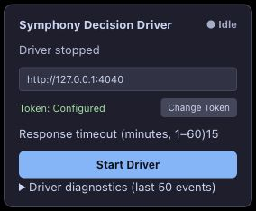

# PR #156 closeout — 2026-10-22

SPEC §4 Decision extension; §7/§8/§14 reconciliation adjacency; §17/§18 validation.

## Final real-browser scenario

The current Edge/Tampermonkey driver started a synthetic Plan bound to an inaccessible conversation UUID. It automatically created a replacement conversation, bootstrapped and rebound the same session, reclaimed the original task and accepted a matching ready result. Claim and binding generations both advanced 1 → 2; recoveryAttempts was 1. No manual Start, refresh or reclaim followed the initial Start. This validates an inaccessible binding, not permanent deletion or recovery-budget exhaustion. See [native readback](inaccessible-readback-2026-10-22.json) and [visible diagnostics](inaccessible-hud-2026-10-22.txt).

The driver was stopped and the isolated Bridge shut down after acceptance. The earlier disposable GitHub branch was restored; no coding worker or merge was authorized.

## Review and build provenance

Parallel Standards and Spec reviews found one P2 metadata-boundary defect and no Spec defect. Restored diagnostics could retain malformed nested wait fields. The final fix reconstructs only validated primitive fields, enums, canonical selectors and nonnegative safe integers; malformed records/fields are dropped. Fourteen focused diagnostics tests passed, and Standards re-review confirmed the defect resolved with no new blocker.

All real-browser scenarios exercised the operator-installed 0.1.4 build before this final diagnostics-restoration hardening. The final source rebuild includes that additional boundary fix; it does not change execution/recovery behavior. Automated gates validate the final source. Final rebuilt userscript SHA-256: `3aa7f6ca5b07a70130b9aa8978e7f9214aafb580e0f8786ca4c699c321b7a5c9`. Real acceptance is not claimed against identical final artifact bytes.

## Final automated validation

Final source passed typecheck/build and all 11 workspace suites: 2,030 tests passed, one existing opt-in test skipped (Web: 204; Decision: 111). Lint initially scanned unpacked local backup sources under the ignored directory; archiving that backup removed those non-product files from its input. Lint and docs checks passed after that housekeeping; the complete gate was then rerun for the final snapshot. No source checks were disabled.

## Remaining scope

Keep #148 open and use existing [#151](https://github.com/felixjichao/symphony-ts/issues/151) for broader recovery fault acceptance. Actual ChatGPT sign-out/login UI, permanent conversation deletion, rebind-budget exhaustion, full browser-process restart and heartbeat-specific 403 remain unverified live. Automated coverage does not mark those scenarios passed. These are follow-up validation gaps, not confirmed defects discovered by this review. No additional issue is needed for duplicate tracking.

This closes the bounded implementation/validation work for PR #156 and prepares it for review; it does not authorize merge or claim complete #148 acceptance.

