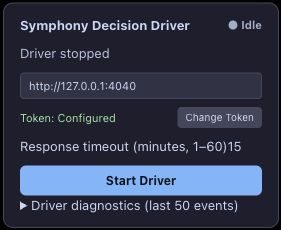

# Userscript 0.1.5 real-environment acceptance — 2026-10-22

SPEC §4 Decision extension; §17/§18 validation. Execution source: PR #156 at `ea5c9887f4457a656b704d5daa4f2541494bb333`, plus a metadata-header-only build fix.

## Installation and composition

The operator confirmed updating the userscript. A fresh logged-in Edge/ChatGPT page loaded Tampermonkey with its existing configured Bridge authorization. Installed bytes were not independently extracted. The previous built artifact SHA was `a1b24a992f51e2b6c6dc9d7a8f9116d758c545d705230690b6a7cd3889068c00`; the fixed single-header artifact SHA is `46ef99b266c3bba575788556171451fb839c49421cb9d87e863a3e93b9f00a47`. Adding exactly one duplicate metadata block to the latter reconstructs the former byte-for-byte, proving the runtime payload is unchanged. See [manifest](live015-build-manifest-2026-10-22.json).

The isolated harness used production DecisionBridge/service/durable store, real wall-clock time, and an authenticated loopback proxy on 4040 → 4041. Synthetic materialized Plans used `symphony-acceptance/pr156#151`; this is not real GitHub issue #151. No coding host or GitHub mutation ran. [Harness](live015-harness-2026-10-22.txt), [sanitized task request trace](live015-requests-2026-10-22.ndjson).

## Passed: active growth and reload recovery

1. Driver bootstrapped a fresh conversation and sent the long Plan once at **17:53:16 Asia/Shanghai**. Native heartbeats reported response lengths **5,542 → 11,876**, advancing progress and renewing the same claim.
2. At **17:54:08**, the response was visibly generating, with two assistant turns and latest length 14,221. The page was reloaded. Driver resumed automatically without Start. [Before reload DOM metadata](live015-before-reload-dom-2026-10-22.json).
3. ChatGPT temporarily omitted the in-flight response from the refreshed DOM: current assistant count fell to 1, equal to baseline 1. For about 98 seconds the only rendered assistant turn was the old bootstrap response. Heartbeats correctly reported zero new response length; native progress did not advance from that static old turn.
4. When the final response became visible again (two turns, latest length 46,496), Driver stabilized, extracted the exact-task result and accepted a ready receipt at **17:55:50**. The diagnostic history contains exactly one task `prompt_submitting` record across reload; the trace contains one result POST. Claim generation remained **1**, binding generation **1**, recoveryAttempts **0**. No repeated task Send or reclaim occurred. [After reload metadata](live015-after-reload-dom-2026-10-22.json), [Driver history](live015-hud-2026-10-22.txt), [native readback](live015-readback-2026-10-22.json).

The first task is `superseded` in final readback because creating the next Plan revision superseded it after successful completion; its generation-1 result receipt remains durable. The before-reload user-message selector returned zero, so that field is not used as proof of Send count; persisted Driver history and native generation/request evidence are used instead.

## Passed: accepted result acknowledgement lost

A brief second Plan ran on the same binding. At **17:58:21**, the real Bridge accepted its result; the proxy consumed the successful upstream response and deliberately destroyed the downstream connection. Driver recovered by GET receipt at **17:58:22** (200). Exactly one result POST reached Bridge for this revision, with no repeated task Send. Final status is completed, receipt verdict ready, claim/binding generation 1. The trace records `accepted_ack_dropped`, followed by receipt readback.

Diagnostic limitation: the history records the initial `result_submit_error`; this receipt-recovery path does not emit an additional `result_accepted` diagnostic. Success is established by the authoritative receipt/readback and the request trace, rather than an invented HUD success event.

## Duplicate metadata declaration fixed

The old Vite `closeBundle` hook modified an already-written file. Vitest loads that same configuration and calls the hook on shutdown: an isolated original-config build produced one declaration, then running the diagnostics tests produced a second (`HEADER_HOOK_BEFORE 0`, then `1`). [Reproduction log](live015-header-reproduction-2026-10-22.txt).

The fix emits the declaration from `generateBundle` on the output chunk and strips any leading metadata blocks before prepending one. It performs no post-test file mutation. Two consecutive builds and the complete gate leave exactly one opening/closing declaration at the beginning; repeated builds produce the same SHA. Userscript version remains 0.1.5 because execution code is unchanged.

`TMPDIR=/private/tmp npm run gate` passed: typecheck/build, **2,042 tests across 11 workspaces**, one existing opt-in skip, lint and docs checks. `git diff --check` passed.

## Boundary and cleanup

This run did **not** naturally exercise a still-visible, growing response with current count below baseline for more than ten minutes. It also did not hit the narrow post-Send/pre-checkpoint crash window. Those review-specific combinations retain automated Driver→Decision and real HTTP regression evidence; they are not relabelled live passes. Auth UI, full browser-process restart and recovery-budget exhaustion remain outside this run. #148/#151 remain open.

Driver was stopped; isolated Bridge/proxy were shut down; no listeners remain on 4040/4041. Published screenshot contains only the Driver HUD, excluding account/sidebar content.

