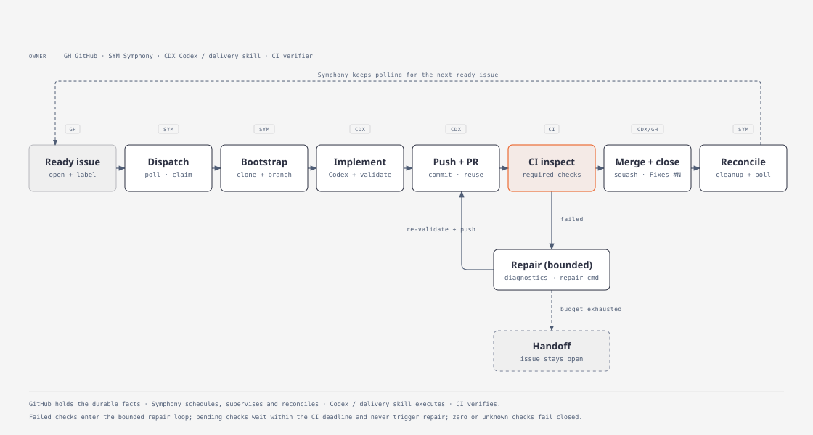
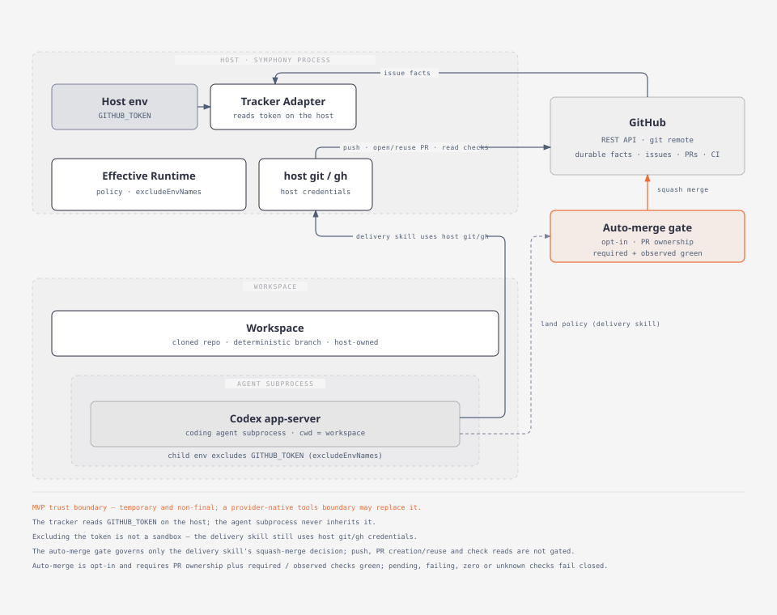

# GitHub delivery loop

This document describes the closed-loop GitHub delivery workflow introduced by
the GitHub Delivery MVP (NEST-89 / #78). It explains who owns which step, what
GitHub facts drive the loop, how the loop starts and stops, and where the MVP
trust boundary sits. The runnable profile is
[examples/github-delivery/WORKFLOW.md](../examples/github-delivery/WORKFLOW.md);
the copy procedure is in [examples/github-delivery/README.md](../examples/github-delivery/README.md).

## Design goals

- **GitHub is the durable work and delivery truth.** Issue state, pull-request
  state, and check state are the facts the loop consumes.
- **Symphony is scheduler / supervisor / reconciler.** It discovers work,
  provisions a workspace, launches and supervises the agent, retries, reconciles,
  and cleans up. It does not embed a pull-request or CI state machine.
- **Codex is the execution agent.** It implements, validates, and drives delivery
  through the delivery skill.
- **CI is the automated verifier.** The loop lands only when every required check
  is green.

The runtime responsibilities already exist in the packages; this workflow adds no
new orchestrator state or second state machine.

## Responsibility split

| Step | Owner | Notes |
|---|---|---|
| Pre-execution Planning | Decision Plane (`symphony plan`) | `ready` verdict + published plan required for dispatch |
| Discover dispatchable issues | Symphony (tracker polling + planning gate) | `open` + `required_labels` (`symphony-ready`) + planning gate eligible |
| Provision per-issue workspace | Symphony (`@symphony/workspace` hook) | `after_create` runs `symphony repo-bootstrap` |
| Implement + run project validation | Codex | Local gate such as `npm run gate`; prompt receives accepted plan |
| Commit / push / create-or-reuse PR / read CI / repair / land | Codex (delivery skill) | `symphony delivery-skill run ... --repair-cmd ... --opt-in` |
| Auto squash-merge decision | Delivery skill, using `@symphony/domain` policy | Opt-in only; ownership-checked; SHA + plan verified |
| Issue closed | GitHub | PR body `Fixes #N` closes the issue on merge |
| Observe terminal issue + cleanup | Symphony (tracker refresh + reconciliation) | Existing path; no new state machine |

Facts that always come from GitHub: whether the issue is `open`/`closed`; whether
a pull request already exists, is open, mergeable, and whether its checks are
green; whether the issue was closed by a merge.

## `symphony-ready` semantics

> **`symphony-ready`**: The Issue has sufficient requirements and an accepted/current implementation plan to enter autonomous execution.

When Decision Plane planning is active, simply tagging `symphony-ready` on an issue is **not sufficient** for autonomous dispatch. The production host's Planning Gate verifies:
1. A PlanTask has been completed with verdict `ready`.
2. All clarifications are resolved.
3. The accepted plan is published to GitHub (with verified comment marker).
4. Current issue title and description match the requirement fingerprint.

An issue carrying `symphony-ready` that has not been planned, is pending planning, needs clarification, or whose requirements were modified will be rejected fail-closed during normal and retry dispatch.

## Pre-execution planning commands

Operators or autonomous planners use `symphony plan`:

```sh
# 1. Start planning session for an issue
symphony plan start --repo owner/repo --issue 123 --title "Feature title" --body "Feature requirements"

# 2. Check planning status and dispatch eligibility
symphony plan status --repo owner/repo --issue 123

# 3. If planner returned needs_clarification, submit clarifications:
symphony plan clarify --repo owner/repo --issue 123 --clarifications "Answer to Q1; Answer to Q2"

# 4. If requirements changed on GitHub:
symphony plan replan --repo owner/repo --issue 123 --body "Updated requirements"

# 5. Publish plan to GitHub issue comment (supports ready, needs_clarification, needs_human):
symphony plan sync --repo owner/repo --issue 123 --publish

# 6. Or sync using an existing GitHub comment ID (verifies comment content & marker):
symphony plan sync --repo owner/repo --issue 123 --comment-id 123456
```

## Start

1. Build the CLI and put it on `PATH` (`npm ci && npm run build`; the binary
   is `apps/cli/dist/bin/symphony.js`).
2. Copy the reference profile into the target repository and fill in the
   repo-specific values (see the [example README](../examples/github-delivery/README.md)).
3. Export `GITHUB_TOKEN`, ensure `git` credentials and an authenticated `gh` are
   available, and make sure `codex app-server` can start.
4. Start the host:

   ```sh
   symphony /path/to/WORKFLOW.md
   ```

An `open` issue carrying `symphony-ready` is then dispatched on the next poll.

## Run

```text
open issue + symphony-ready
  → Symphony polling + dispatch
  → workspace bootstrap (clone + deterministic symphony/<workspaceKey> branch)
  → Codex implement + validate
  → commit + push
  → create or reuse PR (ownership marker + Fixes #N)
  → CI inspect
       ├─ failed → run --repair-cmd → re-validate → push again (bounded)
       └─ green + mergeable
  → Review Gate (SHA-bound review task)
       ├─ changes_requested → run --repair-cmd with findings → re-validate → push again (bounded)
       ├─ needs_human → product-intent clarification
       └─ approve (exact HEAD SHA verified)
  → squash merge (opt-in only)
  → Fixes #N closes the issue
  → Symphony tracker refresh sees closed
  → terminal reconciliation + workspace cleanup
```

ChatGPT Web performs the independent review and returns a verdict bound to the
exact PR HEAD. `approve` allows the host to proceed to merge once the existing
opt-in, ownership, CI and merge-safety checks pass, without an additional human
review. Technical code findings produce actionable `changes_requested` findings for repair/re-review.
Missing evidence/access failures produce an executor `evidence_unavailable` receipt and
stop delivery as an operational block, without spending code-repair budget or requiring
a code mutation. After evidence/access is restored, recovery starts a new review revision
for the same HEAD; no automatic evidence retry is introduced by this policy. `needs_human` is reserved for
unclear product intent and must state the product decision needed. Technical
access failures and exhausted recovery budgets remain operational blocks; they
do not require a human product review. ChatGPT Web does not execute the merge.

The PR body uses `Fixes #N`, so GitHub closes the issue automatically on merge.
Symphony then sees the terminal state through its normal tracker refresh and
releases the workspace — no extra label is involved.



The diagram is the canonical visual for the path above. GitHub holds the durable
work / delivery facts, Symphony schedules, supervises and reconciles, the Codex
delivery skill implements and drives delivery, and CI verifies. Landing requires
CI green and a mergeable PR plus explicit opt-in and PR ownership; a failing
check enters the bounded repair loop, while a pending check waits within the CI
deadline. When the repair budget, the CI deadline or merge safety is exhausted —
or delivery cannot otherwise complete safely — the loop exits through the handoff
path instead of retrying forever. A Chinese-primary version is available at
[github-delivery-loop（中文）](diagrams/zh/github-delivery-loop.svg). Editable
source and regeneration steps: [docs/diagrams/](diagrams/README.md).

## Stop and exit paths

The loop has exactly three outcomes:

1. **Success** — the PR is merged and the issue is `closed`; Symphony observes the
   terminal state and cleans up the workspace. No human merge step.
2. **Retryable failure** — a transient or technical failure (CI failure within
   budget, push error, temporary provider error). The delivery skill repairs
   within a bounded budget (default `--max-repairs 3`, `--max-wait 300`); the
   existing Symphony retry policy handles worker-level failures. A resumed run
   continues from GitHub's current facts rather than a remembered session.
3. **Product blocker / handoff** — the requirements are ambiguous, the change is
   destructive, the change cannot be merged safely, or a budget (repair attempts,
   CI wait) is exhausted. The skill must not guess: it keeps the issue open,
   removes `symphony-ready` to stop further dispatch, and posts an
   operator-visible handoff report.

### Repairing a CI failure

The delivery skill does not guess its way through a failing build. On a CI
failure it fetches the failure diagnostics, runs the configured repair entry
(`--repair-cmd`, with the logs in `SYMPHONY_CI_FAILURE_DIAGNOSTICS`), re-runs
`--validate`, commits and pushes the new changes, and only then re-checks CI.
This repeats up to `--max-repairs` times. A repair command that exits non-zero,
produces no working-tree changes, or pushes no new SHA ends the loop with a
handoff instead of looping forever. The reference profile supplies the repair
entry through `$SYMPHONY_DELIVERY_REPAIR_CMD` (default `npm run ci:fix`), so a
repository that wants unattended repair must provide that command.

### Project validation timeout

`delivery-skill run --validation-timeout 600` gives each `--validate` invocation
its own bounded timeout in seconds (default 600; positive integer, maximum
2147483). The same timeout applies to initial validation and validation after CI
or review repair. Timeout/failure still halts delivery before commit/push/land.
This does not change `--max-wait`, persisted deadlines, repair budgets, or the
60-second defaults for ordinary git/gh subprocesses. A larger validation timeout
does not extend an already-persisted CI deadline.

### Recovering from a handoff

A handoff is explicit, not a dead end:

1. Fix the root cause the handoff describes.
2. Re-add the `symphony-ready` label so Symphony dispatches the issue again:

   ```sh
   gh issue edit <number> --repo <owner/repo> --add-label symphony-ready
   ```

3. The delivery command detects the persisted paused state
   (`<workspace>/.symphony/delivery-state.json` with `"isPaused": true`) and passes
   `--resume` automatically, so the same workspace continues rather than refusing
   to run.

`--resume` deliberately preserves the already-spent repair count and the absolute
CI-wait deadline — it does not grant a new budget, so repeatedly resuming cannot
extend an exhausted budget. Decide whether a new budget round is needed from the
**persisted budget and deadline at recovery time, not only from the original
handoff reason**: even a handoff caused by `unmergeable` or a
permission/infrastructure blocker can outlast the deadline while a human resolves
it, and because `--resume` keeps that deadline the next run would time out
immediately. Whenever the persisted repair count is already at its maximum or the
absolute deadline has passed, an operator must explicitly start a new budget round
by clearing the persisted state before re-adding the label:

```sh
rm <workspace>/.symphony/delivery-state.json
```

Treat that deletion as an operator action: it is the authorization for a fresh,
bounded attempt, not something the agent should do on its own.

Graceful host shutdown uses `SIGINT` / `SIGTERM`; the host closes workers and
resources before exiting.

## Safety: non-Symphony work is never auto-merged

Four layers keep automatic landing scoped to opt-in Symphony work:

1. **Dispatch gate** — `tracker.required_labels: [symphony-ready]`. Only labeled
   issues are scheduled, so unmanaged work never enters the loop.
2. **Explicit opt-in** — the prompt calls `symphony delivery-skill run ... --opt-in`;
   without it the skill stops after CI is green and never merges.
3. **PR ownership** — the PR carries a `symphony-delivery-marker` and must belong
   to the current issue/workspace; foreign PRs, ambiguous candidates, and
   closed-unmerged PRs are rejected.
4. **Check policy** — landing requires the PR to be open, mergeable, and every
   required and observed check to be successful. Pending, failing, zero, or
   unknown checks fail closed.
5. **Review Gate** — landing requires independent review approval bound to the
   current PR `headSha`. Any commit/HEAD change invalidates prior approval.
   Missing gate, `changes_requested`, `needs_human`, or reviewer errors fail closed.

There is no "scan open PRs and merge them" mode.

## Credential / trust boundary (MVP)

The MVP lets the delivery skill use the host's `git` and authenticated `gh` to
perform delivery. This is an explicit, temporary trust boundary:

- The tracker reads `GITHUB_TOKEN` on the host; the agent subprocess never
  inherits it (`excludeEnvNames`).
- `git push` and `gh` calls rely on host-provided credentials (for example
  `gh auth setup-git`), not on a token placed in the workspace.
- The delivery runner redacts classic/fine-grained PATs, bearer headers, and
  credential-bearing URLs from everything it prints.



The diagram shows the same boundary: the tracker reads `GITHUB_TOKEN` on the
host; the agent subprocess never inherits it (`excludeEnvNames`); the delivery
skill still reaches GitHub through host-provided `git` and authenticated `gh` for
push, PR creation/reuse and check reads. The opt-in / ownership / check-policy
gate governs only the delivery skill's squash-merge decision — it is not a
credential layer in front of every GitHub call. Excluding the tracker token does
not sandbox the agent from host credentials, and this is the current
temporary MVP boundary rather than the final provider-native model. A
Chinese-primary version is available at
[delivery-trust-boundary（中文）](diagrams/zh/delivery-trust-boundary.svg).

The loop is now proven by the end-to-end dogfood (#83 / PR #88). A provider-native
tools boundary may replace this temporary boundary in the future; do not treat the
MVP boundary as the final security model.

## Recommended initial values

| Setting | Initial value | Where |
|---|---|---|
| Dispatch label | `symphony-ready` | `tracker.required_labels` |
| Poll interval | `30000` ms | `polling.interval_ms` |
| Concurrent agents | `1` | `agent.max_concurrent_agents` |
| Turns per session | `20` | `agent.max_turns` |
| Hook timeout | `120000` ms | `hooks.timeout_ms` |
| CI repairs | `3` | `--max-repairs` |
| CI wait | `300` s | `--max-wait` |

## Configuration reference

The profile's front matter is the standard Symphony `WORKFLOW.md` service config.
Field semantics and defaults are owned by [`@symphony/config`](../packages/config/README.md)
and the GitHub tracker keys by [`@symphony/tracker`](../packages/tracker/README.md).
The delivery protocol itself is documented in the
[GitHub delivery skill](../skills/github-delivery/SKILL.md) and the
[CLI reference](../apps/cli/README.md).

## Not in scope

This profile does not add dashboards, HTTP surfaces, SSH workers, multiple
providers, durable scheduler state, or a PR/CI state
machine inside the orchestrator. The end-to-end real GitHub + real Codex dogfood
is implemented as an opt-in harness; see
[docs/github-delivery-dogfood.md](github-delivery-dogfood.md) and the target
[template](../examples/github-delivery-dogfood/README.md).

### Durable stage recovery and operator verification

The host keeps invocation/retry records in `<workspace.root>/.symphony-host/`, outside
individual workspace cleanup. Delivery keeps continuation, landing, pause and budget
facts in `.symphony/delivery-state.json`. Restart refreshes GitHub, Decision and native
ownership before acting; it does not rerun initial validation/commit/push. Pending CI
and Review yield to later ticks. Already-merged PRs only gain local acknowledgement;
an open Issue waits for tracker synchronization, without an automatic Issue close.
Review needs-human and paused compensation never silently restart coding.

Scheduled retry reservations retain attempt and UTC expiry; overdue work still
refreshes stage/admission. A killed worker launch becomes `worker_launch_unverified`.
A killed repair remains `repair_outcome_unverified`. A lock with uncertain child
activity remains blocked. These conditions deliberately require verification instead
of starting a second possible executor. Clean dead-owner locks without subprocess
uncertainty can be reclaimed automatically; no lock is stolen by age.

For an ambiguous launch/repair/child: stop affected hosts, identify the old executor/process group for that WorkKey/workspace and verify its
identity before terminating it, inspect local
and remote HEAD/PR/Decision/merge/comment facts, and preserve the snapshots for audit.
Only after proving the old executor cannot continue may an operator release that
exact blocked reservation/lock in the stopped host's state. Never remove a newer
token/nonce or reset budgets to make recovery proceed. Keep unresolved intent records
until native evidence resolves them. Then restart for fresh stage/admission reads;
use explicit `delivery-skill run --resume` only to authorize resuming paused work.
A changed HEAD invalidates an old one-shot `pr land` authorization; issue a new explicit
opt-in for the current target. Corrupt/legacy state and interrupted reclaim metadata
require the same conservative verification, not automatic deletion.

Delivery cleanup also shares an outside-workspace lifecycle mutex in the workspace
parent's `.symphony-host/delivery-authorities/`. Preserve this directory along with
host recovery state when migrating workspace roots. Terminal Issue cleanup refuses
active owners, unknown subprocess outcomes, corrupt state and unacknowledged
Delivery/landing steps; merge auto-closing an Issue does not acknowledge the local
intent. Use native observation/recovery before cleanup. Explicit `delivery-skill
halt` preserves these steps and rejects corrupt or mismatched state.

Auto-land's approved `result_observed` continuation is settled for cleanup only
by an observed merge commit for the same PR, HEAD and branches. A handoff's
`reportDestination` records whether its receipt lives on the Issue or PR;
retaining a business PR target does not change the destination of an explicit
halt report. Recovery queries that same comment collection before posting.

### 已确认合并冲突的有界修复（#186）

绿 CI 与 exact-HEAD approve 后，若合并前权威事实仍为 owned、OPEN、非 draft、HEAD 未变的 `CONFLICTING`，Delivery 使用既有修复次数和绝对 deadline 自动修复。`UNKNOWN`、读取/解析失败、所有权或 HEAD 不符、review 证据失败以及未知 merge outcome 不进入此路径。

修复前必须确认工作区分支/origin 身份，且无已有 dirty/index 改动、merge/rebase/cherry-pick 等进行态；不清理或丢弃现有工作。旧 landing intent 只有在同一 owned PR 的权威 OPEN、`mergeCommit=null` 事实下才能解除。新 landing intent 延迟至真正发起 merge 前写入。

`mergeConflictRepair` 持久记录 `merge_conflict` cause、operationId、attempt、PR、expectedHeadSha、baseSha、phase 与 commit/push 回执；先独立读取 repository/base 的真实远端分支引用，精确 fetch 并检查祖先关系；可修复目标才扣除 `spentRepairs` 并 checkpoint，执行前再核验远端目标和本地 HEAD，正常 merge 同一 base SHA。内置 `codex exec --sandbox workspace-write -`（或注入的 `repairFn`）在原工作区解决冲突；CLI 与 continuity host 共用此默认路径，不依赖 profile 的 CI/review `--repair-cmd`，必须保留 PR 实现与 base 变更，不得提交、推送、reset、abort 或 rebase。Codex prompt 由 stdin 传入；执行器接收 `SYMPHONY_REPAIR_CAUSE=merge_conflict` 和 JSON `SYMPHONY_REPAIR_CONTEXT`（含冲突文件与固定目标）。执行器缺失或未配置本地验证时明确交接。

本地验证与冲突检查通过后，Delivery 创建精确两父 merge commit；再次验证本地身份及远端所有权/HEAD，再普通 push，绝不 force push。base 在修复中前移不会改变已固定的 merge parents；重读最新 GitHub facts 后，新 HEAD 必须重新通过 CI、独立 exact-HEAD review 和原有 merge fence。若再次确认冲突，使用剩余预算再修复。

修复进行中不移除 `symphony-ready`；continuity 展示 repair 与原生 authority 阻塞事实。重启共享原 filesystem/subprocess authority，保留次数和 deadline；有 committed 回执且远端仍为 expected HEAD 时可继续一次正常 push，pushing/pushed 回执只有远端确认新 commit 才能收敛。无完成回执的执行器、未确认 push、dirty 状态或不确定副作用不会重放，保留工作并给出具体交接原因。只有终止时执行原暂停/标签移除/报告补偿流程，Issue 不会因修复失败而关闭。

验证入口：agent 的 `merge-conflict-repair.test.ts` 使用临时真实 Git/共享 bare origin，覆盖冲突到新 CI/review/合入、base 二次前移、多 owned PR、负面门禁和重启回执；CLI 的 delivery storage/continuity 测试覆盖持久化与互斥展示。真实 GitHub/完整 gate 仍由 operator-owned host 验证。

### 真实 base tip、no-op 与历史 merging 恢复（#188）

PR `baseRefOid` 与本地 `origin/<base>` 均不是修复目标的权威来源。tracker 原子读取 `repos/{repo}/git/ref/heads/{base}`，验证完整 ref、commit 类型与 SHA；domain 定义事实/reader，CLI 和 continuity host 用同一 fenced runner 注入 agent。远端引用不可读、响应异常、repository/branch 身份不符或 HEAD 漂移时不开始错误目标 merge。固定的 `baseSha` 用于 fetch、MERGE_HEAD、双亲验证及 push 回执；push 前后独立重读分支，回执的 `current_base` 可与 pinned base 不同。base 再前移不修改旧提交父节点，新 HEAD 重新通过本地验证、CI 和 exact-HEAD Review 后才可 fenced merge。

预算预留前最多观察两组 PR/ref 事实并精确 fetch。若真实 base 已包含于当前 HEAD，但 GitHub 仍宣告冲突，以 `merge_conflict_already_contained` 交接，保留 HEAD/index/worktree、不制造提交、不扣修复次数。若事实变化则明确分类，不无限轮询。执行中的 clean merge、真实冲突、非冲突 git failure、no-op、目标漂移分别处理；实际 no-op 不读取不存在的 MERGE_HEAD，也不判修复成功。已预留后异常退出的次数仍保留。

历史 `phase=reserved/merging`（包括 #171 的旧 base 祖先/no MERGE_HEAD）默认只读核验并交接，不因普通 `--resume` 重放。operator 必须先确认旧宿主和所有 Git/Codex/验证子进程已停止，并核验 native filesystem authority 没有 active owner 或未确认副作用；authority 不确定仍阻塞，以下授权不会移除/改写锁。读取原 operationId、attempt、expectedHeadSha，确认本地与 PR HEAD 同为 expectedHead、index/worktree 干净、无 merge/rebase/cherry-pick 等进行态、owned OPEN PR 无 merge outcome 后，才可在 operator host 显式运行：

```sh
symphony delivery-skill run --repo felixjichao/symphony-ts --issue 171 \
  --workspace-key GH-171 --head symphony/GH-171 --base main --cwd /path/to/GH-171 \
  --resume --recover-conflict-operation 2f4f656b-b46f-489b-b2aa-f57dbd6acca0 \
  --recover-conflict-attempt 1 --expected-head 9d8c5c808cbbfeaadff18efebab49a2c48317a54 \
  --confirm-executor-stopped --validate "npm run gate" --opt-in
```

示例 fence 来自 #188 的历史证据，执行前必须重读实际记录；bridge/review、required checks 等生产参数沿用原授权配置。该原生授权只把**无本地或远端效果**的旧记录写为 `reconciled`，返回 CI 观察；不执行旧 merge、不 abort/reset、不改预算/deadline，也不替新 HEAD 授权 approve。下一次真实修复使用新 operationId 和剩余次数。已过期 deadline/耗尽预算仍阻塞，本命令不延长或重置它们。`executing/validating/committing`、dirty/index、已有 Git 操作、未知远端结果不适用这个自动恢复原语，保持原工作并人工核验。`committed/pushing/pushed` 仍遵循原精确提交/远端回执收敛规则。

隔离 Git 证据与验证范围见 [#188 conformance](conformance.md#github-delivery-authoritative-base-and-no-op-recovery-188)；此变更不对生产 #171、runtime、Decision Store 或历史预算执行任何操作。

### 持续运行中的暂时读取失败（#192）

Review 状态读取仅对已识别的网络、超时、服务暂不可用错误重读，最多连续三次，且受原 absolute deadline 约束；原 task/session/revision/HEAD、operation key 和已消耗修复次数不变，stage yield 保留失败计数。认证、权限、身份或结果损坏仍明确交接。HEAD 前移会重新等待当前 SHA 的 CI 并创建对应 Review。

冲突修复 push 后最多进行三次只读对账，沿用 poll interval 与总期限：远端精确 head ref 和 owned PR HEAD 投影都匹配 commit receipt 才进入新 SHA 的 CI/Review。暂旧或可识别的暂时读取故障先等待；第三个 SHA、所有权/身份变化和未知 merge outcome 拒绝。push 返回 transport error 后也只观察事实，不重复 push 或 executor。

四条提交路径统一枚举并暂存源码，检查 Git 返回码，排除 `.symphony`。普通提交保留原 runtime index；merge 提交拒绝已暂存 runtime，保留 merge 双亲，已跟踪但未改变的 runtime 只继承原树版本，不把本地 runtime 更新提交。无法收敛或额度耗尽时沿用一次逻辑暂停和原标签/报告补偿。以上不增加进程崩溃后的 executor/commit 重放或预算续期能力。

真实 workspace-write 运行时，编码执行器只改源码并验证；commit/push/Delivery 由 operator-owned `after_run` 在可信宿主执行。冲突执行器同样只解决工作文件，不写受保护 Git metadata；host 先检查冲突标记、验证，再统一暂存并检查 index 无未解决条目、runtime 隔离及双亲后提交。见 [#192 真实运行及剩余 cleanup 阻断](evidence/delivery-transient-recovery/issue192-20261028075031/README.md)。
